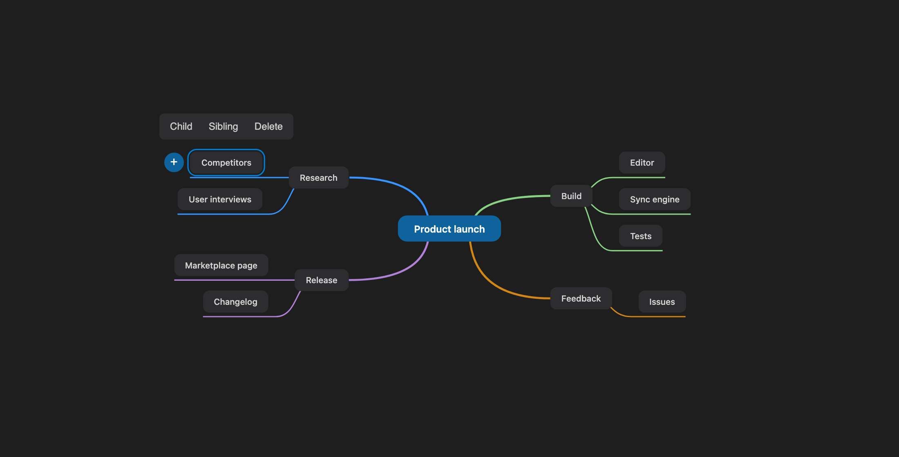

# mind.md

Edit the headings of a Markdown file as a mind map, in VS Code. Your text stays where it is: changing a node rewrites only that heading, and everything else in the file keeps its exact bytes.



## Open a map

Markdown files open as text as usual. The map is there when you ask for it:

- **Beside the text:** click the hierarchy icon at the top right of a `.md` editor, or press `Cmd+Shift+Alt+M` on macOS or `Ctrl+Shift+Alt+M` on Windows and Linux.
- **Instead of the text:** right-click a `.md` file, select **Open With...**, then **Mindmap Editor**.

Each document gets one side panel, which closes when you close the document.

## How the map relates to your file

- **Headings become nodes.** Paragraphs, lists, code blocks and frontmatter do not appear on the map, but they stay in the file. Hashes inside code blocks and frontmatter are not treated as headings.
- **A section moves as a whole.** Moving a node takes its text and sub-headings along and adjusts their levels.
- **Deleting asks first.** If a section contains text, VS Code asks you to confirm. Undo brings it back.
- **The root depends on the document.** A single H1 at the top becomes the root. Otherwise the root shows the file name, which comes from outside the document, so it cannot be renamed and is never written to the file.
- **Both sides stay in sync.** Text edits appear on the map, keeping your selection and folded branches. If the file changes while you edit the map, that map edit is refused with a warning rather than overwriting the newer text.
- **Files stay the way they were.** Line endings and heading styles are kept. A setext heading (underlined with `===` or `---`) becomes a `#` heading only when its level changes.

## Keyboard and mouse

Select a node first. A small toolbar then offers the most common actions.

- `Tab`: add a child
- `Enter`: add a sibling below
- `Shift+Enter`: add a sibling above
- `Ctrl+Enter`: add a parent
- `F2` or double-click: edit the text
- `Delete` or `Backspace`: delete the node
- Arrow keys: move the selection
- `PageUp` and `PageDown`, or `Alt+Up` and `Alt+Down`: reorder among siblings
- `Cmd/Ctrl+C` and `Cmd/Ctrl+V`: copy and paste a node
- `Cmd/Ctrl+Z` and `Cmd/Ctrl+Shift+Z`: undo and redo
- Drag a node: move it
- Drag the canvas or scroll: pan
- `Cmd/Ctrl` + scroll, or `Cmd/Ctrl` + `+` and `-`: zoom
- `Cmd/Ctrl+0`: reset the zoom
- `F1`: center the map

## Limitations

- **Copy and cut carry the heading only.** Paste creates a new heading without the section's text, so `Cmd/Ctrl+X` followed by paste loses that text unless you undo. To keep it, drag the node instead.
- **Headings stop at level 6.** An edit that would go deeper is refused with a message.
- **Node text is raw Markdown.** A heading such as `## **Bold**` shows its asterisks on the map.
- **Headings inside lists, quotes and HTML blocks** are treated as body text, not as nodes.
- **Folding is not saved.** Folded branches reopen when the map is reopened.
- **Desktop only.** The extension does not run in VS Code for the Web.

## Development

```bash
npm install
npm run build
npm run typecheck
npm test                  # unit and property tests
npm run test:integration  # runs in a real VS Code, downloaded on first use
```

To try it, press `F5` to start the Extension Development Host, open a `.md` file and press `Cmd+Shift+Alt+M`.
